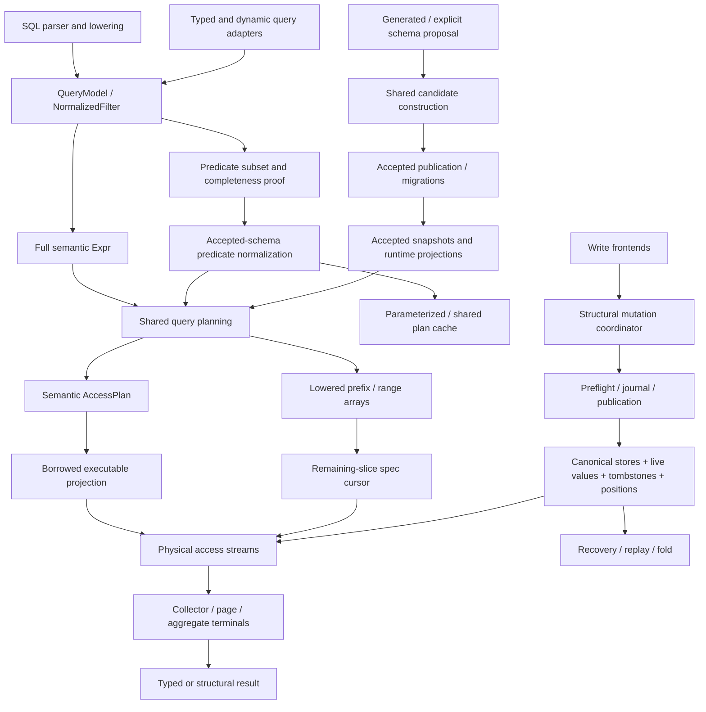
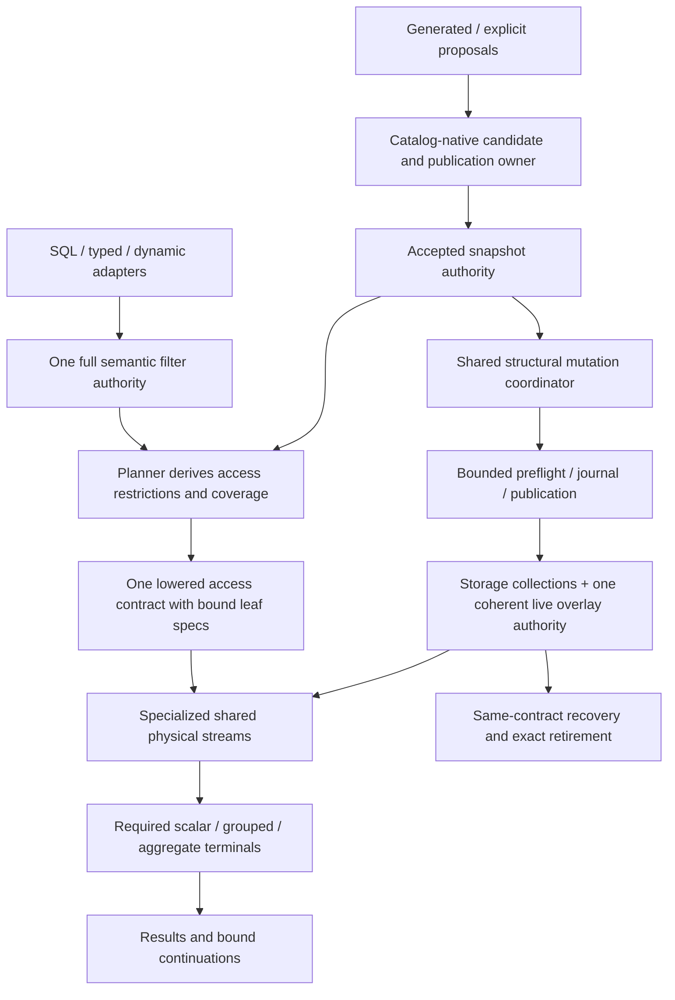

# Architecture and reduction programme

This is a proposed sequence, not release authorization or an implementation
tracker. GitHub remains the follow-up authority. Finding IDs refer to the
[evidence register](findings.md). No release numbers are assigned here.

## Current architecture: inspected boundaries after simplification

This map incorporates the implemented MA-04/05 simplifications. The original
findings preserve the pre-edit observations; [implementation evidence](implementation.md)
records actual changes and retained mechanisms.

This is a responsibility map, not a complete call graph. In particular SQL
mutation, grouping and recovery were not exhaustively traced. Arrows summarize
the inspected owners; they do not claim that every query executes every stage.

## Target to test, not a replacement framework

No crate merger is justified yet. Keep Schema as the runtime-independent
declaration contract, Model/Macros as host generation and typed authoring,
Core as accepted runtime authority, facade as application API, Diagnostic Code
as the public registry and CLI as the independent host tool. Keep real native
qualification separate from product dependencies. Existing approved Core
dev-support exceptions are not new audit defects.

The target removes synchronized representations only if qualification proves
it simpler. It does not merge parsing into admission, raw decoding into trusted
state, or publication into preflight. Those are real boundaries.

## Twenty review hotspots

Ranking is a review priority using representation count, state synchronization,
semantic branching and failure boundaries. It is not a computed cyclomatic
complexity ranking. **Inspected** means the named boundary was read, not every
function in the family. **Inventory only** needs deeper review before findings.

All paths below are relative to `crates/icydb-core/src/` unless otherwise noted.

| Rank | Owner | Why difficult / simplest direction | Coverage |
| ---: | --- | --- | --- |
| 1 | `db/query/intent/state/mod.rs` | Full filter, subset and coverage must agree; narrow the derived view, MA-05 | Inspected |
| 2 | `db/access/execution_contract/`, `db/executor/stream/access/bindings.rs` | Borrowed tree projection and ordered side specs; direct leaf binding remains unproven, MA-04 | Inspected |
| 3 | `db/schema/application/mod.rs` | Initial/replay/pending/migration publication states; remove repeated head/topology derivation first, MA-02/03 | Selected paths |
| 4 | `db/schema/application_lowering/mod.rs` | Removal, identity and candidate assembly; preserve shared construction and explicit trust boundaries | Selected paths |
| 5 | `db/positioned_overlay/mod.rs`, data/index stores | Three containers plus superseded retirement; evaluate coherent entries, MA-08 | Selected paths |
| 6 | `db/session/query/cache/mod.rs` | Parameter contract, operand identity and accepted-root identity; prove reuse before skipping admission | Selected path |
| 7 | `db/predicate/normalize/mod.rs` | Boolean algebra, coercion and charged construction; retain shared recursion, remove repeat callers only | Selected paths |
| 8 | `db/query/plan/expr/predicate/compile/mod.rs` | SQL truth-set to indexable restriction; preserve NULL/unsupported semantics, MA-05 | Selected paths |
| 9 | `db/executor/stream/access/physical/mod.rs` | Physical ordering, materialization, branch merge, continuation; preserve measured specialization | Selected contracts |
| 10 | `db/executor/pipeline/runtime/adapter.rs` | Collector/page/kernel handoff; shared request exists, challenge only additional transformations | Selected methods |
| 11 | `db/schema/info/mod.rs` | Accepted kind, query type, slot/name and nested projections; borrow existing order, MA-07 | Selected paths |
| 12 | `error/mod.rs` | Multiple detail categories and canonical mappings; retire obsolete executor projection, MA-01 | Selected paths |
| 13 | `crates/icydb-model-macros/src/node/typed_adapter/mod.rs` (repository path) | Per-type/per-context instantiations; measure reachability, MA-09 | Generator inspected |
| 14 | `db/executor/mutation/structural/mod.rs` | Identity, after-image, constraints, packing and atomic publication; coordinator already shared | Contracts inspected |
| 15 | `db/schema/migration_planner/mod.rs` | Identity rekeying and reconstruction; establish semantic equivalence before merging with ordinary lowering | Symbol/caller inventory |
| 16 | `db/commit/recovery/mod.rs` | Trap/rollback/replay boundaries are essential; model failure transitions before any deletion | Inventory only |
| 17 | `db/journal/store/mod.rs`, `db/journal/codec/mod.rs` | Durable bounds, checksums, controls and batches; keep decoding checks at trust boundary | Inventory only |
| 18 | `db/relation/reverse_index/mod.rs` | Referential actions and reverse-key authority; do not merge with ordinary indexes on shape alone | Inventory only |
| 19 | `db/executor/aggregate/`, `db/executor/group/` | Streaming/hash/global/grouped distinctions; need actual state and workload comparison | Inventory only |
| 20 | `testing/integration/`, `qualification/`, audit actors (repository paths) | Overlapping setup versus independent semantic boundaries; preserve witnesses while sharing fixture data | Membership + selected pair |

## Programme A — Delete

Start with MA-02, then MA-01 after public-consumer checks. These do not need a new
general abstraction. MA-10 is a small optional fixture cleanup, deferred until
the measurement pair is executable together; do not let it delay useful product
work. There are not five proven safe deletions yet.

## Programme B — Consolidate

MA-03 removes owned topology copies. MA-06 reuses canonical predicate proof.
MA-07 reuses accepted slot order if an existing authoritative representation
can supply it. Keep these independent so each has a reviewable semantic proof.
Do not combine them just to enlarge a LOC total.

## Programme C — Re-architect

MA-04, MA-05 and MA-08 are distinct design studies. Prefer one at a time, with
before/after representation and state-transition inventories. MA-09 is driven
by linked-code and IC measurements, not generic-parameter counts. No approval
for these designs or their implementations is implied by this audit.

## First five proposed slices

| Order | Outcome | Net code target | Net complexity target | Prerequisites and acceptance |
| ---: | --- | --- | --- | --- |
| 1 | Derive actual application head once (MA-02) | 0–10 non-test physical lines removed; tests may add lines | One duplicate derivation removed; no new abstraction | Ordinary, no-op/replay and pending-head distinction unchanged |
| 2 | Remove executor detail representation (MA-01) | Estimated 80–140 non-test physical lines removed; tests unknown | One enum, one outer branch and one mapping eliminated | Search public/generated consumers; same diagnostic code, class, origin and facts |
| 3 | Borrow accepted-after topology (MA-03) | Unestimated until helper propagation; no claim of a large deletion | One owned topology projection removed; no generic overlay | Relation-target and empty-domain refusal preserved before any publication |
| 4 | Hash canonical predicates directly where proven (MA-06) | Estimated 0–30 non-test physical lines removed | One redundant normalization/copy pass removed | All affected callers proven canonical; identity and budget tests unchanged |
| 5 | Reuse accepted field-slot order (MA-07) | Unestimated; reject a new cache that costs more than it removes | Remove per-call sort/projection without another authority | Layout-owner access established; rename/drop/sparse-slot/budget tests |

These are source-inspection estimates, not measured net cloc. Before handing off
each implemented slice, replace estimates with actual non-test and test deltas,
including additions, propagation and changed fixtures. MA-04/05 have greater
potential but do not yet have an honest bounded deletion budget.

No proposed first-five slice changes durable encoding. Preserve failure-before-
publication behavior. Ordinary source rollback remains possible before delivery;
that statement is not permission to revert unrelated work. Any later persisted
format change needs a separate explicit retained-data/recovery plan.

## Measurement and qualification

### Source and complexity

Use the adopted cloc classification for implementation deltas, with identical
source selection before and after. Preserve test/non-test split; exclude file
moves from savings. The [inventory](inventory.md) uses physical lines only for
search priority and must not be used as the cloc baseline.

For every slice record removed and added mechanisms, data representations,
runtime transformations, state variables, modules, public/internal types,
traits, dependencies and ownership edges. A helper extraction is not a net
complexity reduction unless the total independently maintained policy shrinks.
Count the replacement implementation and its tests too. Never sum overlapping
MA-05/06 or nested source ranges as independent savings.

### Wasm and IC

Use the existing `qualification/build/src/wasm_measurement/mod.rs` subjects and
one/ten reachable-entity actors for generated-code work. Capture exact source,
all relevant lockfiles, Rust toolchain, target, feature sets, linker and
post-link optimizer flags. Compare identical workloads and initialization state.

Report both total uncompressed Wasm bytes and code-section bytes, before and
after optimization when the fixture supplies both. Keep schema-only reachability
distinct from callable operations. Report per-added-entity deltas using the
maintained nine-additional-entity pair. Do not compare differently configured
artifacts or infer compiled savings from Rust LOC.

Use actual IC instruction/cycle observations for cost claims. Do not run native
timing or query-latency benchmarks. Trace allocations and storage operations only
as causal evidence; they are not a substitute metric. If Canic or another fixture
dependency blocks execution, report the comparison unmeasured. Testkit remains
the PocketIC provisioning/admission/lifecycle owner.

### Semantic qualification

- Query changes: SQL/typed/dynamic equivalence, null/missing/coercion cases,
  predicate-only/partial extraction, cache rebinding, budget refusal, ASC/DESC,
  union/intersection and exact continuation identity.
- Schema changes: initial and existing applications, no-op/replay, pending
  activation, cross-store relations, rename/removal and mismatched authority.
- Storage changes: live-before-canonical reads, tombstones, exact/superseded
  retirement, interrupted replay/fold, retained corruption and fail-closed
  publication. Native simulations alone do not qualify IC trap/rollback.
- Codec changes: generated boundary tests plus matched reachable Wasm subjects;
  preserve accepted-schema authority and model-only host compilation.
- Fixture cleanup: preserve every distinct boundary witness. Repeated setup may
  be shared; independent recovery/security/installed tests are not duplicates
  merely because their expected result agrees.

Select focused tests for each actual implementation. This documentation-only
audit does not authorize or require a full workspace/release gate. No performance
or macOS evidence is produced by documentation checks.

## Remaining audit work

The original brief's exhaustive semantic review remains incomplete. Highest
value further inspection is the full MA-04 access lowering caller chain, MA-05
predicate-only origins and coverage transitions, external uses of MA-01, then
recovery/journal and aggregate/group state machines. Dependency deadness,
macro-expanded public surfaces, CLI flows and the remaining qualification
packages need their own evidence before deletion claims. Keep new evidence in
this report; accepted actionable follow-up belongs in GitHub, not a second
local task queue.
