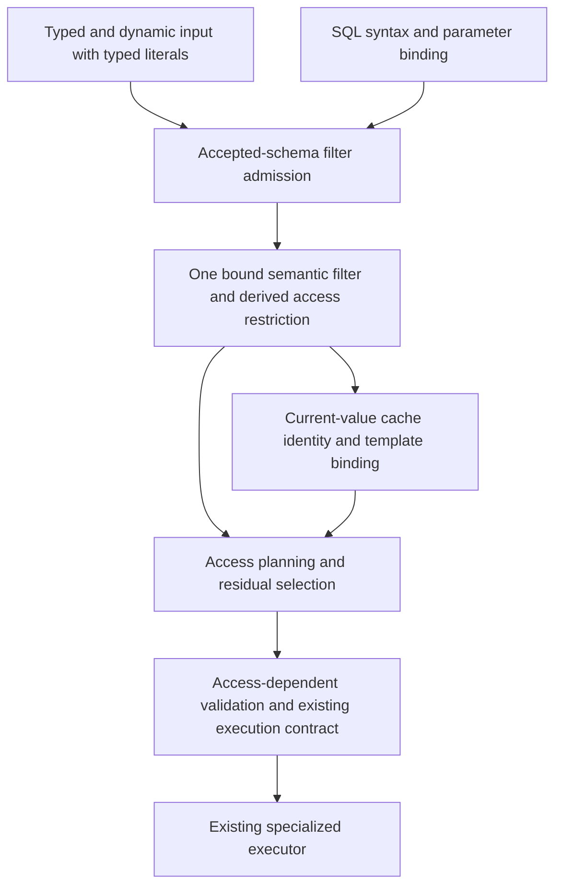

# Query admission: consolidation design

Architectural investigation requested on 2026-11-12 after the maintainer asked
for subsystem reductions rather than further local helper cleanup. This is a
source-backed design proposal, not an implemented migration, exhaustive proof,
or authorization to start another minor line.

## Verdict

There are not three independent query engines to merge. Typed reads wrap dynamic
requests; SQL and dynamic reads converge on structural intent, shared planning,
cache handling and a common page executor. The stronger opportunity is to retire
repeated preparation stages and the synchronization between their outputs.

Recommend one accepted-schema-bound filter admission owner, replacing the split
between frontend canonicalization, intent-derived predicates and planner-owned
predicate reconstruction. Separately remove the typed-literal string round trip
at the public filter boundary. These are substantive contract changes; do not
implement them as a collection of wrapper removals.

## Current end-to-end ownership

| Stage | Source evidence | Actual responsibility |
| --- | --- | --- |
| Typed authoring | [typed query](../../../crates/icydb/src/db/query/typed.rs), `TypedQuery` request/filter methods | Holds a `DynamicQuery` and an opaque accepted binding; output uses generated decoding |
| Dynamic literals | [filter DTO/lowering](../../../crates/icydb-core/src/db/query/expr/filter.rs), `FilterValue::from_input_value`, `lower_value`, `lower_compare` | Converts many typed values into strings, then lowers them into runtime text and canonicalizes using schema |
| Dynamic intent | [dynamic session](../../../crates/icydb-core/src/db/session/query/dynamic.rs), `lower_dynamic_query` family | Checks input/shape, builds one StructuralQuery against accepted catalog; adds order/projection/grouping |
| SQL parameters | [SQL bindings](../../../crates/icydb-core/src/db/sql/lowering/bindings.rs), `admit_compare_or_expression` | Lowers a comparison, compiles a predicate, normalizes/validates operands, then writes canonical values back into SQL syntax |
| SQL filter lowering | [select lowering](../../../crates/icydb-core/src/db/sql/lowering/select/mod.rs), `LoweredSqlFilter::apply_to_query`; [literal adapter, now admission-owned](../../../crates/icydb-core/src/db/query/intent/filter/sql.rs) | Carries expression plus optional predicate, canonicalizes both, and attaches them to intent |
| Intent filter | [intent state](../../../crates/icydb-core/src/db/query/intent/state.rs), `NormalizedFilter`; [model](../../../crates/icydb-core/src/db/query/intent/model.rs) | Normalizes expression, derives predicate and tracks complete coverage; accepts a prederived SQL pair or predicate-only input |
| Planner admission | [pipeline](../../../crates/icydb-core/src/db/query/plan/pipeline.rs), `prepare_query_model_scalar_planning_state_with_schema_info` | Validates policy, records original key-input resource facts, reconstructs schema-normalized predicate, then folds constants |
| Predicate reconstruction | [access planner](../../../crates/icydb-core/src/db/query/plan/access_planner.rs), `normalize_query_predicate`; [predicate normalization](../../../crates/icydb-core/src/db/predicate/normalize.rs) | Copies/coerces predicate values against accepted field contracts and normalizes boolean structure again |
| Cache | [query cache](../../../crates/icydb-core/src/db/session/query/cache.rs) | Derives parameter/value identity from current prepared predicate; accepts only current authority/visibility and cardinality lifecycle |
| Planned residual | [plan contracts](../../../crates/icydb-core/src/db/query/plan/access_plan.rs), `ResidualFilterContract` | Retains residual expression/predicate and one effective executable filter contract |
| Row execution | [dynamic session](../../../crates/icydb-core/src/db/session/query/dynamic.rs), `ScalarPageInput` | Dynamic and SQL entry shapes feed common page admission/execution/cursor ownership |

This trace covers scalar filter preparation and its cache/executor handoff.
Grouped/HAVING, aggregate FILTER, mutations and special exact-count routes are
migration consumers requiring explicit propagation, not claimed fully audited.

## Confirmed duplication versus necessary distinctions

**Confirmed:** typed builder values such as Nat64, Decimal and Principal become
`FilterValue::String`; lowering later creates Value::Text and asks accepted schema
to recover the intended kind. Typed authoring is using a narrow wire-oriented
representation as its internal literal transport. The source also has a map
Debug-string conversion; this is evidence of a representation boundary needing
review, not a claim that map comparisons are currently supported correctly.

**Confirmed:** predicate derivation normalizes its result in
`compile_normalized_bool_expr_to_predicate_impl`, while scalar planning rebuilds
and normalizes it after schema value normalization. SQL also maintains an
expression/predicate pair through its own canonicalizers. These are multiple
passes over related facts. They cannot simply be deleted today: schema coercion
can change values and boolean normalization must then see those changes.

**Confirmed:** SQL parameter admission creates temporary semantic structures and
writes values back into syntax before ordinary lowering. Its early validation is
intentional: invalid operands must reject even in branches later folded away.
Retire the syntax round trip only by preserving that early admission obligation.

**Not established as redundant:** expression versus access predicate. SQL has
three-valued logic and expressions outside the indexable predicate subset. The
truth-set compiler, coverage proof and residual filter remain necessary. Likewise,
input limits, operand admission, access-dependent plan validation and public-read
policy are different gates, not duplicate validation merely because all reject.

**Not established:** every expression/predicate pair is evaluated twice at runtime.
The effective filter supports an expression and independently remaining predicate;
executor behavior must be assessed per assembled contract. This proposal does not
claim a second executor can be deleted.

## Proposed architecture

Use one private admitted-filter artifact in place of the current unbound/derived
filter handoff, not an additional long-lived wrapper layered on top. It owns the
full semantics and the derived access restriction together, records the accepted
schema authority used for binding, and carries original input-resource facts that
constant folding would erase. Private construction ensures callers cannot assert
normalization/coverage without the admission owner producing them.

Frontend adapters still own syntax and explicit literal policy: SQL integer-token
inference must not silently become dynamic strict-equality behavior. The shared
owner resolves fields and canonical values, validates operands before folding,
normalizes full semantics, derives the access restriction once and exposes it to
cache and planner. Appending a clause invalidates/rebuilds admission; schema root
changes require rebinding. An admitted artifact is not portable across revisions.

Do not build a universal AST or executor abstraction. Retain SQL parsing,
expression semantics, predicate truth-set compilation, access planning and
specialized runtime programs. The consolidation target is where these are invoked
and who owns their admitted result.

## Removal ledger and acceptance conditions

| Mechanism to retire | Replacement | Required proof |
| --- | --- | --- |
| Typed input → formatted text → schema reparsing | Typed public literal representation consumed directly | Round-trip serialization and operator semantics, all supported numeric/identity/container kinds |
| SQL expression/predicate canonicalization as parallel authorities | Frontend literal-policy adapter feeding one schema-binding owner | Strict SQL conversion, field-to-field, NULL, enums and unsupported expression parity |
| Intent predicate derivation followed by planner reconstruction | Admit once against current schema; planner consumes that owned result | No skipped operand/enum admission; original key resource facts retained; stale authority refusal |
| SQL bind → temporary expression/predicate → rewritten SQL → lower again | Bound values enter semantic admission directly | Wrong operands in dead branches still reject before folding; parameter positions and diagnostics preserved |
| Caller-asserted expression/predicate synchronization | Private construction of the admitted filter | Partial extraction and predicate-only input remain correct; exact access removes only proved residuals |

Some functions may retain smaller syntax-specific portions. Removal is accepted
only when the old production route is deleted, not kept behind a mode flag or
fallback. No honest net LOC or Wasm saving can be supplied yet: adaptation and
qualification code must be counted alongside removed implementations.

## Four meaningful implementation slices

1. **Typed literal contract:** replace stringification as the common internal
   transport, propagate through serialization/input admission and typed/dynamic
   builders, remove the old conversion machinery. This can be a public hard cut;
   establish the release boundary before implementation. Do not add a parallel
   typed-only query engine to preserve the old DTO indefinitely.
2. **Bound filter authority:** replace intent/planner filter handoff with the one
   private admitted artifact for dynamic and SQL filters. Move schema coercion
   ahead of the single derivation, preserve pre-fold validation/resource facts,
   and remove superseded SQL/intent/planner reconstruction paths in this slice.
3. **Direct SQL parameter admission:** bind current parameter values into the
   shared semantic boundary without rewriting admitted literals back into SQL
   syntax. Delete the superseded leaf reconstruction/writeback route, preserving
   early rejection and prepared statement reuse after schema changes.
4. **Consumer closure and qualification:** propagate the maintained contract to
   grouped/HAVING, aggregate FILTER, mutation selectors and exact-count callers;
   remove any transitional route before closeout. Qualify the complete selected
   boundary family and report remaining intentional representations.

Each slice includes its direct tests, diagnostics and docs; slice 4 is cross-route
closure, not permission to defer basic tests or leave dual production paths after
a slice. If slice 2 cannot close a required consumer coherently, include that
consumer there rather than shipping an unqualified fallback.

## Semantic qualification and stop conditions

Use table-driven cross-surface cases for supported equivalent SQL/typed/dynamic
queries, comparing rows, typed errors, access/residual decisions, cache reuse and
continuation identity. Include NULL/missing/empty, strict versus widening numeric
comparison, signed widths, Decimal/U256, enum/newtype/composite values, IN lists,
field comparisons, CASE/functions and mixed supported/unsupported predicates.

Preserve tests in `unit_ordering` for wrong SQL operands before dead-branch folding,
current parameter values, range type refusal and stale prepared authority. Retain
planner-watermark/template-accounting tests for failed admission leaving the old
memo intact. Cover full/partial predicate extraction, exact-key residual removal,
visibility changes, current cardinality evidence and authenticated continuations.

Record baseline and candidate with identical source selection/features: net test
and non-test code, number of independently maintained admission owners, owned
filter representations, full-tree transformations and their callers. Measure
complete uncompressed Wasm and code-section bytes plus IC instructions/cycles on
matched cold, warm-identical and warm-changed-parameter workloads when available.
Native elapsed time is not a substitute. No measurements were run for this audit.

Stop or revise if consolidation creates more representations, forces all queries
through a generic runtime evaluator, loses partial-index extraction, weakens
pre-fold admission, obscures diagnostics or requires a permanent old/new switch.
If byte identities must change, make that an explicit pre-1.0 contract decision;
do not silently invalidate continuations while describing the change as cleanup.

## Recommendation and current status

Proceed with this programme rather than more independent small helper removals.
First settle the typed literal/public contract and the admitted artifact's exact
ownership against the listed callers, then implement one end-to-end slice at a
time. The existing 0.310 batch remains focused-ready; this document selects no
new minor, package version, deployment or runtime migration.

Investigation delta: **0 production / 0 test code lines**. Documentation/link and
diff checks qualify this design only. Broad tests and release gates were not run;
Wasm/IC effects and implementation LOC savings remain unmeasured.

## Slice 2 boundary investigation — 2026-11-12

The maintainer has since authorized 0.310; slice 1 is complete. The continuation
review checked Toko's [consumer exposure](toko-filter-impact.md) and tested the
SQL filter handoff as the next removal boundary.

All LoweredSqlFilter constructors supply a visible expression. Its optional
expression nevertheless admits predicate-only and empty states; the predicate-only
branch is the sole production caller into predicate-only query intent. Removing
that branch made strict library Clippy expose the now-unused intent constructor,
append machinery and FilterSemanticAuthority::PredicateOnly variant. Tests still
construct that state directly. This is source/compiler evidence of an unreachable
production route, not evidence that executable predicate-only access filters are
obsolete: those are a separate, necessary executor contract.

An exploratory removal of the stored SQL predicate mirror was discarded. UPDATE
and aggregate constructors currently derive a predicate to enforce their admission
contract. Discarding it and deriving again after schema binding removes retained
state but adds a transformation. That does not satisfy this programme's reduction
criterion. The experiment is not part of the source candidate.

The next coherent removal must cover the impossible SQL states and predicate-only
intent together, migrating fixtures to expression-backed input or direct planner
contracts. Preserve their substantive coverage: failed admission retains prior
intent, exact-key residual removal, partial-expression conjunction, original key
resource facts, warmed cache identity, prefix accounting and grouped explain.
Delete tests whose only purpose is asserting the retired representation. Do not
add a test-only compatibility constructor or keep the production variant under a
mode switch. SQL UPDATE's pre-scalar-normalization admission remains distinct
from its final visible expression; the shared owner must preserve that gate.

PreparedScalarPlanningState already retains the accepted SchemaInfo handle and
normalized predicate for cache/planning reuse. Prefer extending that existing
owner over adding a second admitted-state wrapper. Removal of planner operand
normalization must also preserve field-to-field coercion, enum identity and
current-schema binding; the function's historical enum-only name understates its
responsibility.

Continuation result: no retained production/test edits (0/0 code delta). Strict
Core Clippy passes after restoring the experiment, and 99 existing unit-ordering
session tests pass, including dead-branch operand rejection and stale-authority
checks. No claim of slice 2 completion, broad qualification, Wasm reduction or IC
cycle/instruction improvement is made.

The subsequent [removal map](query-admission-removal-map.md) narrows the planning-
state recommendation: exact-count consumes intent before scalar planning, so
that state must not become a mandatory admission entrypoint. It also identifies
the live residual tests to migrate and the SQL membership writeback copy site.

## Bound-filter implementation — 2026-11-12

The shared admission owner now replaces the earlier unbound intent filter. It
owns accepted store/schema authority plus entity identity, full expression,
normalized predicate subset, coverage proof and original key-input summary.
SQL no longer supplies an independently asserted expression/predicate pair;
its literal policy adapter lives behind the admission constructor. Appended
clauses preserve their independent coverage and input summaries.

Planning borrows the admitted predicate and copies it only when constructing an
owned plan. Exact-count validates the same authority without full scalar planning.
Metadata-only global aggregates also validate the filter. Compiled SQL retention
checks both database-wide root identity and the store-local admission authority;
a same-contract heap-root rebuild recompiles the bound command.

The required-predicate SQL capability gate remains before admission. UPDATE now
uses that predicate-capable expression throughout, rather than pairing it with a
separate scalar rewrite. Parameter pre-fold validation and execution-local SQL
substitution remain: direct semantic parameter binding is still slice 3.
Strict covering fixtures now enter the planner assembly boundary directly, so
frontend numeric widening does not replace their intended strict-contract proof.

Qualification and code deltas are recorded in the
[current tracker](../../design/0.310-query-admission/status.md).
